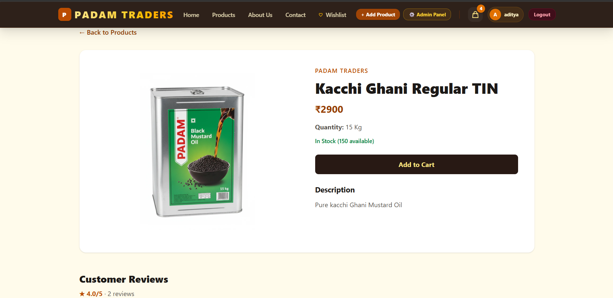
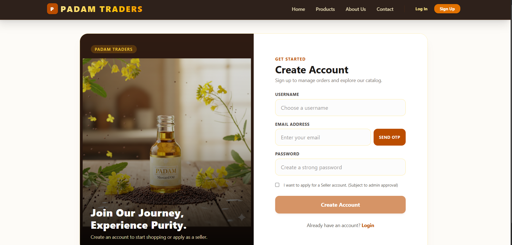
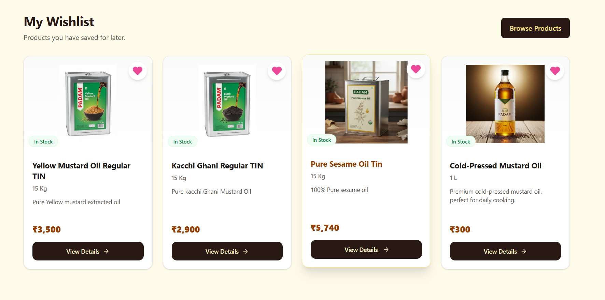
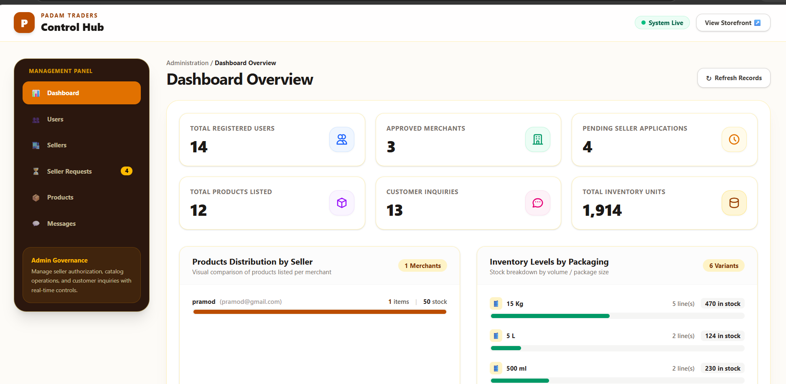

<div align="center">

# 🌿 PADAM TRADERS

### Modern Full-Stack E-Commerce Web Application

A robust, full-stack e-commerce platform featuring a high-performance React frontend and a secure Express/MongoDB backend architecture.

[](https://padam-traders-frontend.onrender.com)
[](https://padam-traders.onrender.com)
[](LICENSE)

[Live Application](https://padam-traders-frontend.onrender.com) · [API Endpoint](https://padam-traders.onrender.com) · [Report Issue](https://github.com/aditya25122005/PADAM_TRADERS/issues)

---

</div>

## 📖 Overview

**PADAM Traders** is a production-grade full-stack e-commerce web platform engineered with the **MERN** stack (MongoDB, Express.js, React.js, Node.js). 

The platform delivers a secure, seamless online shopping experience with features ranging from real-time email OTP account verification, cross-subdomain JWT cookie session persistence, role-based access control (RBAC) for admins and sellers, to interactive product reviews and cart management.

### Key Highlights
- 🔐 **Cross-Origin Authentication:** Secure JWT-based authentication using HTTP-only, `SameSite=None` cookies configured specifically for production deployment across distinct subdomains.
- ⚡ **Lightning Fast Frontend:** Vite-powered React 18 client styled with Tailwind CSS for high performance and responsiveness.
- 🛡️ **Role-Based Access Control (RBAC):** Strict permission layers separating standard Customers, Verified Sellers, and Platform Administrators.
- 📬 **Automated Email Service:** Integrated email verification workflow powered by Nodemailer and OTP validation.

---

## ✨ Features

### 👤 User Authentication & Security
- **Email OTP Verification:** Real-time email OTP dispatch during signup for user authentication.
- **Persistent Sessions:** Cross-site HTTP-only `accessToken` cookie management preventing XSS attacks.
- **Google OAuth 2.0 Integration:** Direct single sign-on option via Google Authentication strategy.
- **Protected Routes:** Granular access guards for client navigation and API endpoints.

### 🛍️ Storefront & E-Commerce Core
- **Product Catalog:** Real-time retrieval of products with detailed view specifications.
- **Cart & Wishlist Systems:** Persistent state management for user shopping carts and saved items.
- **Rating & Review Engine:** Customer reviews with ratings, authorization checks, and moderation.
- **Responsive Navigation:** Optimized layout across mobile, tablet, and desktop viewports.

### 💼 Management & Administration
- **Seller Portal:** Seller application workflows and specialized inventory management.
- **Admin Dashboard:** Control panel for platform content, customer reviews, and account permissions.
- **Contact Communications:** Direct customer enquiry and feedback channel.

---

## 📸 Application Preview

<div align="center">

### 🏠 Home Page


### 🛍️ Product Catalog


### 📦 Product Details & Reviews


### 🔐 Authentication
| Login Page | Registration Page |
| :---: | :---: |
|  |  |

### 🛒 Shopping Cart & Wishlist
| Shopping Cart | Wishlist |
| :---: | :---: |
|  |  |

### 🛠️ Admin Dashboard


</div>

---

## 🛠️ Tech Stack

| Domain | Technologies |
| :--- | :--- |
| **Frontend Framework** | React.js (Vite), React Router DOM |
| **Styling & UI** | Tailwind CSS, Lucide Icons |
| **Backend Runtime** | Node.js, Express.js |
| **Database & ORM** | MongoDB, Mongoose ODM |
| **Authentication** | JSON Web Tokens (JWT), Passport.js (Local & Google OAuth 2.0), Cookie-Parser |
| **Security & Validation** | CORS, Joi Validation Engine, HttpOnly / SameSite Security |
| **Email Services** | Nodemailer (SMTP / Gmail App Passwords) |
| **Deployment Platform**| Render (Web Service & Static Site) |

---

## 🗂️ Repository Architecture

```text
PADAM_TRADERS/
├── client/                     # Frontend Application (React + Vite)
│   ├── src/
│   │   ├── components/         # Reusable UI Components (Navbar, Cards, Modals)
│   │   ├── pages/              # View Routes (Home, Products, Cart, Admin)
│   │   ├── services/           # Axios API Client Setup
│   │   └── context/            # Global State Management
│   └── package.json
│
├── server/                     # Backend API Service (Node.js + Express)
│   ├── config/                 # Passport & OAuth Configurations
│   ├── middleware/             # Auth Guards, RBAC, Validation Middleware
│   ├── models/                 # Mongoose Database Schemas (User, Product, Review)
│   ├── routes/                 # Express API Endpoint Modules
│   ├── utils/                  # JWT Signing & Mailer Helper Utilities
│   └── app.js                  # Main Express Application Pipeline
│
├── screenshots/                # Visual Assets for Documentation
├── .gitignore
└── README.md