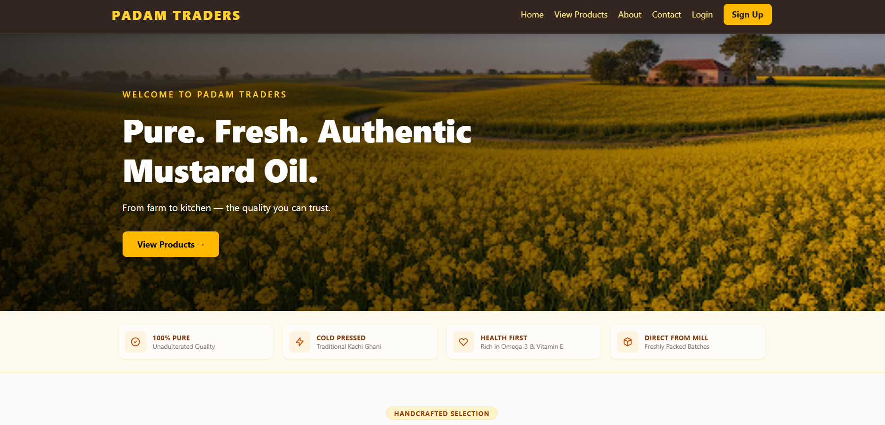
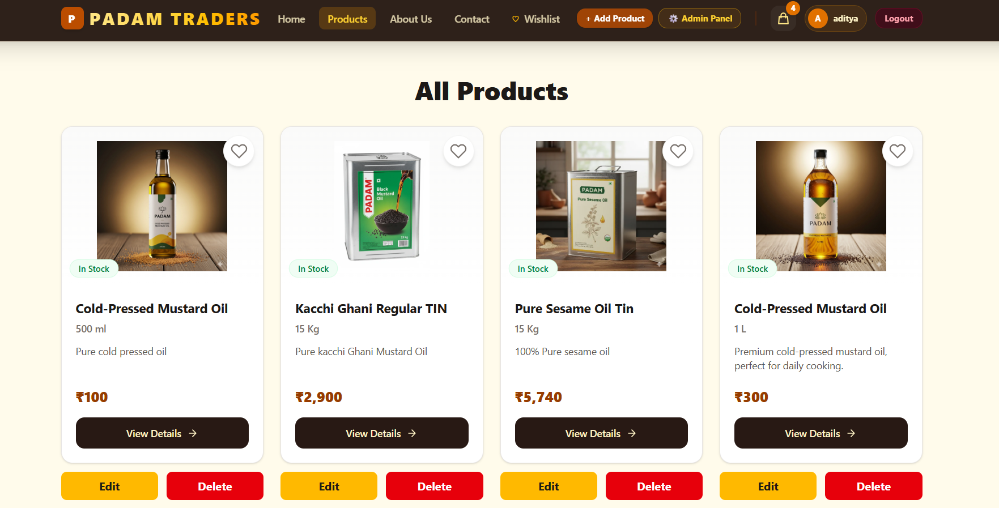
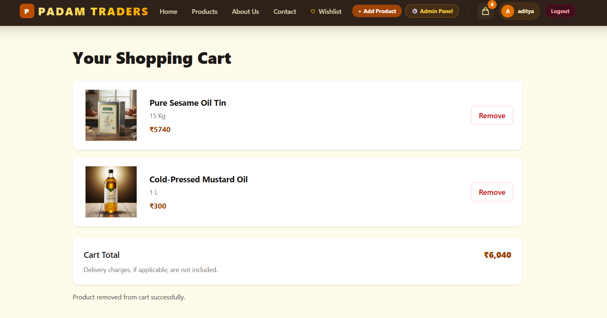
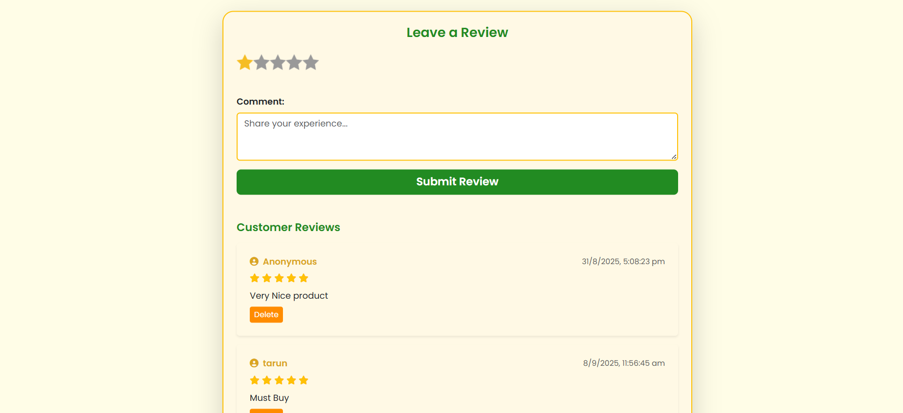
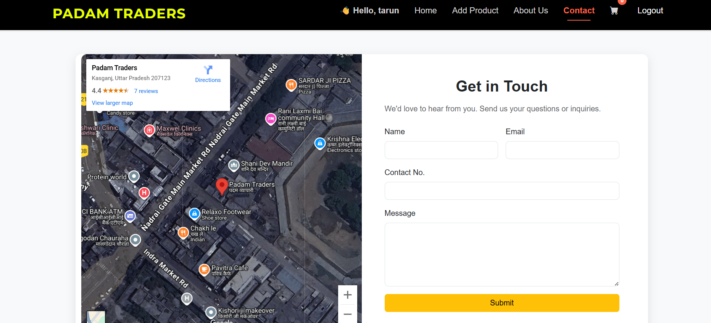
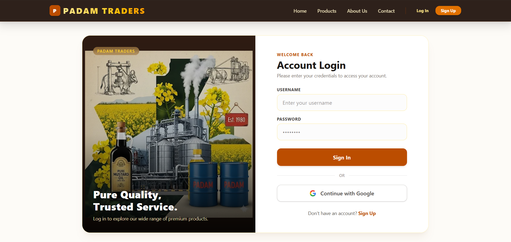

# 🌿 Padam Traders — E-Commerce Web Application

Padam Traders is a full-stack e-commerce web application designed to provide customers with a convenient online shopping experience and administrators with product management capabilities. It features a mustard-yellow and earthy-green theme inspired by mustard oil branding.

## ✨ Key Features

### 👤 Authentication and Authorization
- User registration and login using JWT-based authentication.
- Token-based authentication for protected API endpoints.
- Role-based access control for administrators and customers, where implemented.
- Protected routes for authorized operations.

### 🛍️ Shopping Experience
- Browse products with details and images.
- Add and remove products from the shopping cart.
- Automatic cart total calculation.
- Wishlist functionality to save favorite products.
- Checkout and contact pages.

### 🛠️ Admin Dashboard
- Add, update, and delete product listings.
- Manage product information through administrative interfaces.
- User and order management, where implemented.

### ✅ Server-Side Validation
- Validate incoming request data before processing.
- Handle invalid inputs to maintain data integrity.
- Apply validation to supported forms and API endpoints.

### 📞 Contact Page
- Contact form for customer queries and messages.

### 🎨 Responsive User Interface
- React-based frontend.
- Mustard-yellow and earthy-green color palette.
- Responsive layouts for desktop and mobile screens.
- Interactive UI elements and hover effects.

## 🛠️ Tech Stack

| Component | Technology |
|---|---|
| Frontend | React.js, JavaScript, HTML, CSS, Bootstrap (if used) |
| Backend | Node.js, Express.js |
| Database | MongoDB, Mongoose |
| Authentication | JSON Web Tokens (JWT) |
| API Communication | REST APIs |
| Version Control | Git, GitHub |

## 🏗️ Application Architecture

The application follows a client-server architecture.

- **Frontend:** React.js provides the user interface and communicates with the backend through API requests.
- **Backend:** Node.js and Express.js handle business logic and API endpoints.
- **Authentication Middleware:** Verifies JWTs before allowing access to protected endpoints.
- **Authorization:** Restricts administrative operations according to user roles, where implemented.
- **Database:** MongoDB stores application data, with Mongoose managing database models and queries.

## 📸 Screenshots

Add screenshots to the `screenshots/` directory and update the filenames below to match the actual files.

### Homepage


### Products Page


### Home Page


### Cart


### Reviews


### Checkout / Contact


### Login and Signup


## 🚀 Getting Started

### Prerequisites
- Node.js and npm
- MongoDB instance
- Git

### Installation

1. Clone the repository:

   ```bash
   git clone <YOUR_REPOSITORY_URL>
   ```

2. Navigate to the project directory:

   ```bash
   cd <PROJECT_DIRECTORY>
   ```

3. Install dependencies in the relevant frontend and backend directories according to the project structure.

4. Configure the required environment variables in the appropriate `.env` file or files.

5. Start the backend and frontend using the commands defined in their respective `package.json` files.

6. Open the frontend's local URL in your browser.

**Note:** Refer to the actual project structure and package scripts for the correct setup commands. Never commit real database credentials, JWT secrets, or other sensitive environment variables.

## 🎯 Project Objective

Padam Traders demonstrates full-stack web development by combining a React frontend, Express.js backend, MongoDB database, REST APIs, and JWT-based authentication. The application brings together product browsing, cart and wishlist functionality, and administrative features in one e-commerce platform.

## 🔮 Potential Improvements

- Integrate a payment gateway.
- Add automated tests for important API endpoints and user flows.
- Improve product search, filtering, and pagination.
- Enhance order tracking and order management.
- Strengthen API security, validation, and error handling.

---

**Padam Traders** — A full-stack e-commerce experience inspired by natural mustard oil branding.
